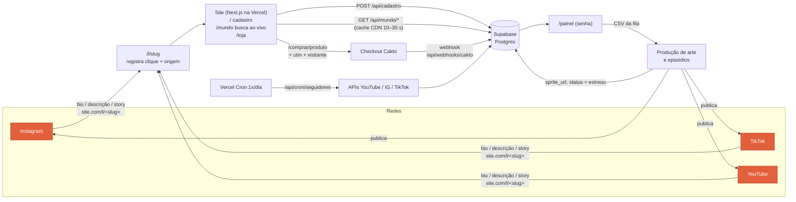

# Arquitetura

## Visão geral



**Por que essa pilha:** Next.js + Vercel + Supabase dá site, API, cron e banco Postgres de verdade
sem servidor para administrar, com plano gratuito para começar e upgrade simples quando crescer.
A Cakto cuida de pagamento, nota e antifraude. O site só redireciona para lá e escuta o webhook.

## Estrutura de pastas

```
NovaMarte/
├── app/
│   ├── page.tsx                 # Home: explicação + formulário de cadastro + contador ao vivo
│   ├── mundo/page.tsx           # Mundo ao vivo (canvas) + busca por nome/@/código
│   ├── loja/page.tsx            # Vitrine (lê `produtos`, cache de 60 s)
│   ├── privacidade/page.tsx     # Política LGPD (MODELO: revisar)
│   ├── painel/
│   │   ├── page.tsx             # Painel: KPIs, seguidores, origens, funil, loja, fila
│   │   └── acoes.ts             # Ações do painel (lançar seguidores, mudar status, reprocessar)
│   ├── l/[slug]/route.ts        # Link rastreável → clique + cookie de origem → redireciona
│   ├── comprar/[slug]/route.ts  # Botão comprar → clique + utm/visitante → checkout Cakto
│   └── api/
│       ├── cadastro/            # POST: cria personagem (valida, deduplica, grava origem)
│       ├── mundo/area/          # GET: personagens de um quarteirão 32x32
│       ├── mundo/busca/         # GET: busca por nome, @ ou código
│       ├── mundo/resumo/        # GET: total + últimos que chegaram
│       ├── webhooks/cakto/      # POST: vendas, reembolsos, chargebacks
│       ├── cron/seguidores/     # GET (cron): contagem diária de seguidores
│       └── painel/export/       # GET: CSV de cadastros (com senha)
├── components/
│   ├── Cadastro.tsx             # Formulário (honeypot + consentimento LGPD)
│   ├── Mundo.tsx                # Mapa: arrastar, zoom, pinça, destaque, “acabou de chegar”
│   └── Contador.tsx
├── lib/
│   ├── supabase.ts              # Cliente do banco (service role, só no servidor)
│   ├── origem.ts                # Cookies de origem: primeiro e último toque
│   ├── cakto.ts                 # Tradução do webhook da Cakto → pedidos
│   ├── seguidores.ts            # Coleta YouTube / Instagram / TikTok
│   ├── sprite.ts                # Boneco provisório gerado do seed
│   ├── mundo.ts                 # Geometria do mundo (largura 256, quarteirão 32)
│   ├── texto.ts                 # Normalização de nome, @, WhatsApp, moeda
│   └── limite.ts                # Limite de requisições por IP
├── supabase/
│   ├── schema.sql               # Tabelas, índices, views do painel, segurança
│   └── seed.sql                 # Links, episódio e produto de exemplo
├── docs/                        # Este arquivo, PROCESSOS.md, ESCALA.md
├── middleware.ts                # Senha do painel + captura de origem em toda página
├── vercel.json                  # Cron diário
└── .env.example                 # Todas as chaves necessárias
```

## Banco de dados

| Tabela | Uma linha é… | Campos-chave |
|---|---|---|
| `personagens` | um seguidor cadastrado | `codigo` (NM000123), `pos_x/pos_y` (casa fixa), `whatsapp` (único), `status`, **`origem_*`** (primeiro toque), **`ultimo_*`** (último toque), `visitante_id` |
| `links` | um link rastreável | `slug`, `plataforma`, `campanha`, `destino` |
| `cliques` | um clique em link ou em “comprar” | `tipo`, `alvo`, `visitante_id`, `source` |
| `episodios` | um episódio publicado | `numero`, URLs das 3 redes |
| `produtos` | um item da loja | `checkout_url` (Cakto), `cakto_product_id`, `episodio_id` |
| `pedidos` | uma venda (atualizada a cada evento) | `cakto_order_id` (único), `status`, `valor_centavos`, `personagem_id` |
| `webhook_eventos` | um webhook recebido, cru | `payload` (jsonb), `processado`, `erro` |
| `seguidores_snapshot` | seguidores de uma rede num dia | `plataforma`, `data`, `seguidores`, `fonte` |
| `integracoes` | um token que gira | `chave`, `valor` |

Views prontas para o painel: `v_kpis`, `v_cadastros_diarios`, `v_origens`, `v_funil_links`,
`v_produtos_desempenho`, `v_seguidores`, `v_status_personagens`. Também dá para consultá-las no
SQL Editor do Supabase ou ligar no Looker Studio/Metabase depois.

## Como a origem é rastreada (“de onde cada pessoa veio”)

1. A pessoa clica em `site.com/l/tt-ep012` (link da descrição do episódio 12 no TikTok).
2. `/l/[slug]` grava um **clique** e o cookie `nm_ft` (primeiro toque, gravado só uma vez) e `nm_lt` (último toque):
   `{source: tiktok, campaign: ep012, link: tt-ep012}`. Depois redireciona.
3. Sem link rastreável, o `middleware.ts` faz o mesmo a partir de `?utm_source=`/`?ref=` ou do *referer* (ex.: `l.instagram.com` vira `instagram`).
4. No cadastro, `/api/cadastro` copia os dois toques para as colunas `origem_*` e `ultimo_*` do personagem.
5. Na compra, `/comprar/<produto>` manda `utm_*` + `src`/`sck` = visitante para a Cakto. O webhook liga a venda ao personagem
   pelo visitante (se a Cakto devolver o campo) **ou** pelo telefone do comprador = WhatsApp do cadastro.

Resultado: no painel você vê, por rede, campanha e link, **cliques → cadastros → compradores → receita**.

## Mundo ao vivo e busca

- Cada personagem tem uma **casa fixa** calculada a partir do id: `x = (id−1) mod 256` e `y = (id−1) div 256`. Ninguém disputa lugar e a posição nunca muda.
- O mapa carrega por **quarteirões de 32×32** (`/api/mundo/area`), só os visíveis. Cada quarteirão fica 15 s no cache da CDN, então mil pessoas olhando o mesmo pedaço custam uma consulta ao banco.
- Todo cadastro já aparece com um **boneco provisório** gerado do `seed` (`lib/sprite.ts`). Quando a arte final fica pronta, `sprite_url` substitui o boneco.
- A busca usa trigramas (`pg_trgm`): acha “joao” em “João”, aceita erro de digitação, @ e código.
- O público só vê `nome_exibicao` (primeiro nome + inicial). **WhatsApp nunca sai do servidor.**

## Segurança

- O banco só é acessado pelo servidor do site com a service role. A chave pública do Supabase não lê nada (RLS ligado, sem políticas, grants revogados).
- `/painel` e `/api/painel/*` ficam atrás de senha (middleware + verificação nas ações).
- O webhook da Cakto exige um token na URL (ou um secret no corpo), comparado em tempo constante. Todo evento é salvo cru antes de ser processado.
- No cadastro há honeypot, limite por IP, validação de WhatsApp, deduplicação por WhatsApp e por @, e consentimento obrigatório.
- O CSV exportado tem proteção contra injeção de fórmula no Excel/Sheets.
