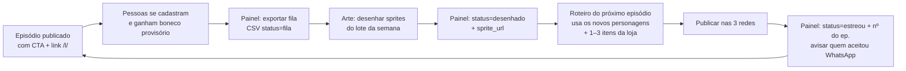

# Processos

## O ciclo (uma volta por episódio)

## Rotina semanal

| Quando | O quê | Onde |
|---|---|---|
| **Segunda** | Olhar o painel: cadastros, origem e funil por link. Decidir o lote de personagens da semana (ex.: 30 por episódio). | `/painel` |
| **Segunda** | Baixar a fila (`Baixar fila (CSV)`) e escolher o lote. Sugestão: ordem de chegada, com espaço reservado para quem veio do episódio anterior (recompensa o engajamento). | `/painel` |
| **Ter–Qua** | Desenhar os sprites. Subir os PNGs no Supabase Storage (bucket público `sprites/`) e colar a URL no painel: código, `desenhado`, URL. | Supabase Storage + `/painel` |
| **Qua** | Definir 1–3 itens do episódio. Criar cada produto na Cakto, inserir na tabela `produtos` com `episodio_id`. Desenhar o item em pixel art (`imagem_url`). | Cakto + Supabase |
| **Qua** | Criar o registro do episódio em `episodios` e os links rastreáveis: `ig-ep013`, `tt-ep013`, `yt-ep013`, `ig-ep013-story`… | Supabase → Table Editor |
| **Qui** | Produzir e montar o episódio. No final, CTA: *“Quer virar personagem? Link na bio”*. Mostrar nomes/@ na tela (todos autorizaram no cadastro). | Edição |
| **Sex** | Publicar nas 3 redes, cada uma com o **seu** link `/l/`. Marcar o lote como `estreou` + nº do episódio. | Redes + `/painel` |
| **Sex** | Avisar no WhatsApp **só quem marcou “quero receber aviso”** (`aceita_whatsapp = true`). | WhatsApp Business |
| **Diário** | O cron puxa os seguidores às 8h (horário de Brasília). Se uma API falhar, o painel mostra o último valor, e dá para lançar à mão. | automático |

## Nomes dos links (padrão)

`<rede>-<onde>` → `ig-bio`, `tt-bio`, `yt-bio`, `ig-ep013`, `tt-ep013-comentario`, `yt-ep013-desc`, `ig-story-loja-1211`.
Um link para cada lugar onde ele aparece. Assim o painel mostra exatamente **qual post** trouxe gente.
Campo `campanha` = o episódio (`ep013`), para agrupar as 3 redes.

## Loja

- Itens baratos (R$ 2,90 a R$ 9,90), cada um ligado a um episódio. Na loja aparece “Aparece no ep. 13”.
- Para criar: produto na Cakto → copiar link de checkout e id → `insert` em `produtos` (`slug`, `nome`, `preco_centavos`, `checkout_url`, `cakto_product_id`, `episodio_id`, `imagem_url`).
- Para tirar da loja: `ativo = false` (o histórico de vendas continua).
- O que se entrega: defina e escreva na descrição do produto na Cakto (ex.: wallpaper/PNG do item, o item aparece no personagem do comprador num próximo episódio, nome nos créditos). **Tem que ser algo que você consegue cumprir em escala.**

### Validar a Cakto (fazer uma vez, antes de vender)

1. Cadastre o webhook e clique em **Enviar teste** no painel da Cakto.
2. No Supabase, abra `webhook_eventos`: a linha nova mostra o JSON que a Cakto manda.
3. Confira se os caminhos em `lib/cakto.ts` (`CAMPOS`) batem com os nomes do JSON (id do pedido, status, valor, produto, cliente, utm). Se algum não bater, ajuste só a lista.
4. Confira se o valor vem em reais (`9.9`) ou centavos (`990`) e ajuste `CAKTO_VALOR_EM_CENTAVOS`.
5. Faça uma compra real de R$ 1 com o seu WhatsApp cadastrado. O pedido deve aparecer no painel **ligado ao seu personagem**. Depois reembolse e veja o status virar `reembolsado`.
6. Se algum webhook ficar com erro, corrija `CAMPOS` e clique em **Reprocessar** no painel. Nada se perde.

## Métricas que importam (todas no painel)

| Métrica | Pergunta que responde |
|---|---|
| Seguidores por rede + Δ 7 dias | Qual rede está crescendo? |
| Seguidor → cadastro | O CTA do episódio está funcionando? |
| Funil por link (cliques → cadastros → vendas) | **Qual post** traz gente que compra? |
| Origens (source/campanha) | Qual rede traz cadastros e qual traz receita? |
| Cadastro → comprador, ticket médio | A loja está madura para itens mais caros? |
| Fila vs. estreados | A produção de arte está acompanhando os cadastros? |

## LGPD e regras das plataformas

- O cadastro só passa com o consentimento marcado. O aviso por WhatsApp é **opt-in separado**.
- **WhatsApp:** só mande mensagem para quem tem `aceita_whatsapp = true`, uma a uma ou por lista de transmissão (que só chega a quem salvou seu número). Para disparo em volume, use a WhatsApp Cloud API com templates aprovados. Disparo em massa sem opt-in derruba o número.
- **Pedido de exclusão:** ache a pessoa pelo código ou WhatsApp, `delete` em `personagens` (os pedidos ficam com `personagem_id` nulo; os dados fiscais da compra ficam com a Cakto).
- **Moderação:** nomes ou @ ofensivos são ocultados pelo painel (“ocultar”). A pessoa some do mundo e da busca na hora.
- **Menores:** público de pixel art atrai adolescentes. Considere pedir “tenho 13 anos ou mais” (ou 18 para comprar) e revise a política com um advogado.
- A página `/privacidade` é um **modelo**: preencha os colchetes antes de publicar.
- Mencionar @ de pessoas nos episódios: todos autorizaram no cadastro. Mesmo assim, use o nome do personagem na tela e não marque contas automaticamente.
